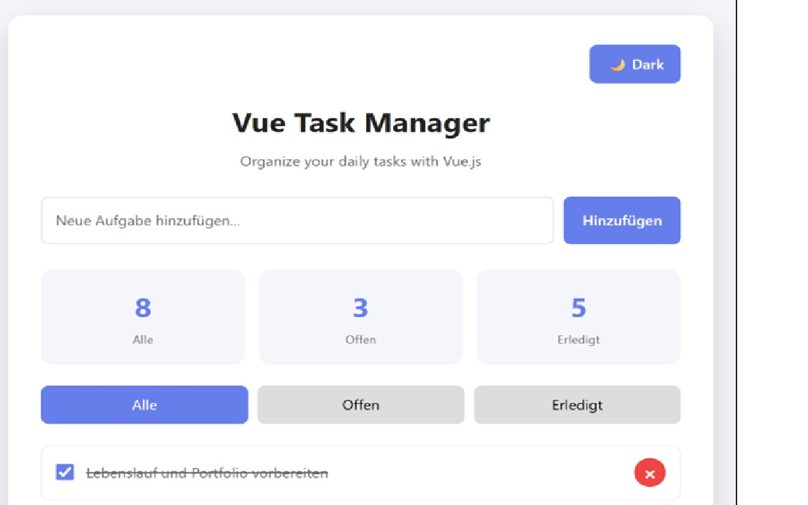

# Vue Task Manager

Das ist ein kleines Projekt, das ich mit Vue.js 3 entwickelt habe, um meine Kenntnisse in der Webentwicklung zu erweitern und praktisch anzuwenden.

Mit der Anwendung kann man eigene Aufgaben hinzufügen, als erledigt markieren, löschen und nach ihrem Status filtern. Außerdem gibt es einen Dark Mode und die Möglichkeit, Aufgaben im Local Storage des Browsers zu speichern.

## Screenshot



## Live Demo

[Vue Task Manager ausprobieren](https://mrbegas.github.io/vue-task-manager-app/)

## Funktionen

- Neue Aufgaben hinzufügen
- Aufgaben als erledigt markieren
- Aufgaben löschen
- Aufgaben nach Status filtern (Alle, Offen, Erledigt)
- Anzahl aller, offenen und erledigten Aufgaben anzeigen
- Zwischen Light Mode und Dark Mode wechseln
- Aufgaben und Einstellungen im Local Storage speichern
- Responsive Darstellung für verschiedene Bildschirmgrößen
- Kleine Animationen und zusätzliche Interaktionen
- Kleines Easter Egg

## Verwendete Technologien

- Vue.js 3
- HTML5
- CSS3
- JavaScript (ES6)
- Local Storage API

## Projektstruktur

```text
vue-task-manager-app/
│
├── index.html
├── style.css
├── app.js
├── screenshot.png
└── README.md
```

## Was ich bei diesem Projekt gelernt habe

Bei der Umsetzung habe ich mich vor allem mit folgenden Themen beschäftigt:

- Grundlagen von Vue.js 3
- Vue-Direktiven wie `v-model`, `v-for` und `v-if`
- Computed Properties und Methods
- Watchers und Lifecycle Hooks
- Umgang mit Events
- Speichern und Laden von Daten mit Local Storage
- Responsive Webdesign
- CSS-Variablen und Dark Mode
- Arbeiten mit JavaScript-Arrays und Objekten

## Mögliche Erweiterungen

Das Projekt möchte ich bei Gelegenheit noch erweitern. Denkbar wären zum Beispiel:

- Aufgaben bearbeiten
- Kategorien für Aufgaben
- Fälligkeitsdaten hinzufügen
- Aufgaben per Drag & Drop sortieren
- Eine Anbindung an ein Backend
- Benutzerkonten und Anmeldung

## Über das Projekt

Dieses Projekt habe ich ursprünglich im Rahmen meiner Weiterbildung zum Webentwickler bei der ILS als praktische Aufgabe für eine Bewertung erstellt.

Anschließend habe ich das Projekt weiterentwickelt und überarbeitet, um es in mein persönliches Portfolio aufzunehmen. Dabei war es mir wichtig, meine Kenntnisse in Vue.js 3 praktisch anzuwenden und eine kleine, funktionierende Anwendung zu entwickeln.

Bei der Entwicklung habe ich auch KI-Tools unterstützend eingesetzt, um Ideen zu sammeln, Lösungsansätze zu überprüfen und einzelne Aufgaben effizienter umzusetzen. Dabei war es mir wichtig, den Code und die verwendeten Funktionen selbst nachzuvollziehen.

Das Projekt hat mir geholfen, mein Verständnis für dynamische Inhalte, Datenverwaltung und Benutzerinteraktionen mit Vue.js zu vertiefen.

## Autor

**Semir B.**

[GitHub-Profil](https://github.com/MrBegaS)

